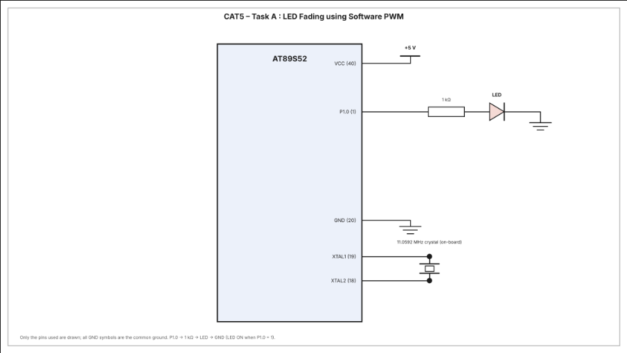

# CAT5 – ADC-Based Analog Sensor Reading and Digital Conversion

## EXP
CAT5

## DATE
10/08/2026

## NAME OF EXP
ADC-Based Analog Sensor Reading and Digital Conversion

## HARDWARE SETUP / PLATFORM
- **Development Board:** 8051 Development Board
- **Microcontroller:** AT89S52
- **CPU Core:** 8051-compatible 8-bit microcontroller core
- **Programming Environment:** Keil µVision
- **Programming Language:** Embedded C
- **ADC Module:** External ADC (ADC0808/0809 or equivalent)
- **Analog Input:** Potentiometer / Sensor connected to analog input channel
- **Display:** Four LEDs (P3.0–P3.3) for digital output indication
- **SPI/Parallel Interface:** GPIO-controlled ADC interface

## TASK NO
1. Interface an external ADC module with the AT89S52 microcontroller.
2. Read the analog voltage from a sensor or potentiometer.
3. Convert the analog signal to an 8-bit digital value.
4. Display the digital output on LEDs or the seven-segment display.

## Circuit Diagram




```text
              AT89S52 (8051)                           ADC0804
          +--------------------+               +--------------------+
          |    P1.0-P1.7 (Bus) |<==============| DB0-DB7 (Pins 18-11)
          |      P3.5 (Pin 15) |-------------->| START / CS (Pin 3,1)
          |      P3.4 (Pin 14) |<--------------| EOC / INTR (Pin 5)
          |      P3.3 (Pin 13) |-------------->| OE / RD (Pin 2)
          |                    |               | Vin(+) <--- Pot / Sensor
          +--------------------+               +--------------------+
```

The circuit consists of an AT89S52 microcontroller connected to an external ADC module. The analog input is sourced from a potentiometer or sensor, and the digital output is displayed on the development board.

## Core Logic / Pseudocode / Code Base

The experiment demonstrates analog-to-digital conversion using an external ADC interfaced with the AT89S52 microcontroller.

**Working:**

1. Initialize the ADC control pins as GPIO outputs.
2. Select the appropriate analog input channel.
3. Trigger the ADC start conversion pulse.
4. Wait for the end-of-conversion (EOC) signal.
5. Read the 8-bit digital output from the ADC data bus.
6. Display the digital value on the output peripherals.
7. Repeat the process continuously.

**Pseudocode:**

```text
START

Initialize ADC control pins (OE, ALE, START, EOC)

WHILE (1)
    Set channel address on address lines
    Pulse ALE to latch the channel address
    Pulse START to begin conversion
    Wait for EOC to go LOW then HIGH (conversion complete)
    Assert OE to enable output
    Read 8-bit digital value from data bus
    Display value on LEDs/Seven-Segment display
    De-assert OE
END WHILE
```

**Source Code:** `main.c`

## INFERENCE

The experiment demonstrates the interfacing of an external ADC module with the AT89S52 microcontroller for analog-to-digital conversion.

The control signals (ALE, START, OE, EOC) were managed using direct GPIO register access. The 8-bit digital output was successfully read from the ADC data bus and displayed on the output peripherals.

The experiment provides hands-on experience with ADC interfacing, analog signal acquisition and digital signal processing at the register level using Embedded C.
