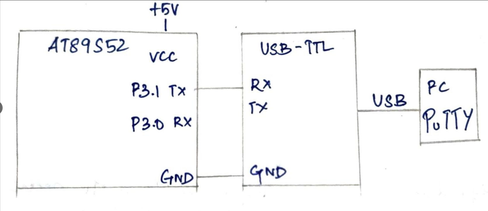

# CAT6 – UART Driver and Serial Debugging

## EXP
CAT6

## DATE
17/08/2026

## NAME OF EXP
UART Driver and Serial Debugging

## HARDWARE SETUP / PLATFORM
- **Development Board:** 8051 Development Board
- **Microcontroller:** AT89S52
- **Crystal Frequency:** 11.0592 MHz
- **Serial Communication Interface:** USB-to-TTL Converter
- **PC Terminal Software:** PuTTY
- **UART Configuration:** 9600-8-N-1
  - Baud Rate: 9600 bps
  - Data Bits: 8
  - Parity: None
  - Stop Bits: 1
- **Baud Rate Generator:** Timer 1, Mode 2 (8-bit auto-reload)
- **UART Operating Mode:** Mode 1 (8-bit asynchronous serial communication)

The AT89S52 uses its alternate-function serial communication pins:
- **P3.1 (TXD):** Serial data transmission
- **P3.0 (RXD):** Serial data reception

## TASK NO

### Task 1 – UART Initialization and Character Transmission

Configure the AT89S52 UART for 9600-8-N-1 communication and continuously transmit the message `Hello from 8051` to a PC terminal using PuTTY.

### Task 2 – UART Echo

Receive characters transmitted from the PC terminal through UART and transmit the same characters back to the PC.

For example, when the user types `ABC123` in PuTTY, the 8051 receives the characters and sends them back to the terminal.

## Circuit Diagram




**Hardware Connections:**

| AT89S52 / Board Pin | USB-to-TTL Converter |
|---|---|
| P3.1 (TXD) | RXD |
| P3.0 (RXD) | TXD |
| GND | GND |

```text
              AT89S52 (8051)                        USB-UART Bridge / PC
          +--------------------+                    +------------------+
          |     P3.1 (TXD) Pin |------------------->| RXD (Pin)        |
          |     P3.0 (RXD) Pin |<-------------------| TXD (Pin)        |
          |                GND |--------------------| GND              |
          +--------------------+                    +------------------+
          Baud Rate: 9600 Baud, 8N1 (Timer 1 Mode 2 Reload = 0xFD)
```

The USB-to-TTL converter is connected to the PC through USB and communicates with PuTTY through the corresponding serial COM port.

The board uses an external 11.0592 MHz crystal connected to the AT89S52 oscillator pins (XTAL1 and XTAL2).

## Core Logic / Pseudocode / Code Base

### Task 1 – UART Initialization and Character Transmission

**Core Logic:**

1. Configure the UART in Mode 1 for 8-bit asynchronous serial communication.
2. Configure Timer 1 in Mode 2 to generate the required baud rate.
3. Load TH1 with `0xFD` for 9600 baud using an 11.0592 MHz crystal.
4. Start Timer 1.
5. Store the message `Hello from 8051` in a character array.
6. Transmit each character through SBUF.
7. Wait until the TI flag becomes 1, indicating completion of transmission.
8. Clear TI and continue transmitting the remaining characters.
9. Repeat the message continuously.

**Pseudocode:**

```text
START

1. Initialize UART:
   - Configure UART Mode 1.
   - Configure Timer 1 in Mode 2.
   - Load TH1 with 0xFD.
   - Start Timer 1.

2. Store "Hello from 8051" in a character array.

3. REPEAT FOREVER:
   FOR each character in the message:
      a. Load character into SBUF.
      b. Wait until TI = 1.
      c. Clear TI.

END
```

**Code Base:** `main.c`

### Task 2 – UART Echo

**Pseudocode:**

```text
START

1. Initialize UART with REN = 1 (enable reception).
2. REPEAT FOREVER:
   a. Wait until RI = 1.
   b. Read the received character from SBUF.
   c. Clear RI.
   d. Load the received character into SBUF.
   e. Wait until TI = 1.
   f. Clear TI.

END
```

## INFERENCE

The experiment demonstrates serial communication between the AT89S52 microcontroller and a PC terminal using UART.

UART Mode 1 was configured for 8-bit asynchronous communication, while Timer 1 in Mode 2 generated the baud rate of 9600 using the 11.0592 MHz crystal.

In Task 1, the microcontroller continuously transmitted a predefined message to the PC terminal. In Task 2, the microcontroller received characters from the PC and transmitted the same characters back, demonstrating UART echo functionality.

The TI and RI flags were used to monitor the completion of character transmission and reception respectively.
