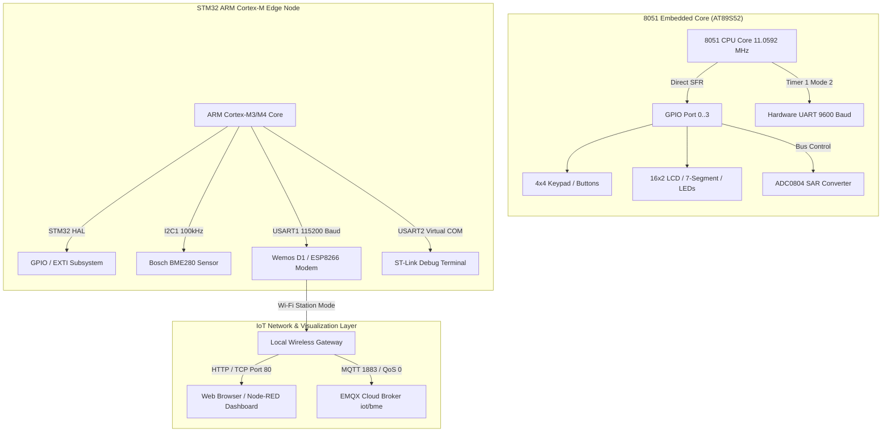

# Fundamentals of Internet of Things (FIoT) Lab: Complete Laboratory Repository

| Course Information | Details |
|---|---|
| **Student Name** | Anuritha B |
| **Register Number** | 25011102016 |
| **Course Code & Title** | 25CS2741 – Fundamentals of Internet of Things + Lab |
| **Academic Year & Semester** | II Year / III Semester B.Tech CSE (IoT) |
| **Department** | Department of Computer Science and Engineering |
| **Institution** | Shiv Nadar University Chennai |

---

## 1. Project Title
**25CS2741 – Fundamentals of Internet of Things Laboratory Repository: Dual-Platform Embedded & Connected Systems (8051 & STM32 ARM Cortex-M)**

---

## 2. Project Overview
This repository hosts the complete, verified, and structured laboratory implementations for the **Fundamentals of Internet of Things (FIoT)** course. Spanning continuous lab assessments from **CAT2 through CAT14**, the projects progress from bare-metal 8-bit embedded control to advanced 32-bit connected IoT edge computing, sensory acquisition, local web serving, and cloud MQTT telemetry.

The repository is divided into two primary hardware domains:
1. **8051 Platform (AT89S52, 8-bit Microcontroller):** Bare-metal GPIO manipulation, timer-based state machines, matrix keypad human-machine interfacing (HMI), multi-channel Analog-to-Digital Conversion (ADC0804/ADC0808), full-duplex asynchronous serial UART, and 16x2 HD44780 character LCD driver development.
2. **STM32 Platform (ARM Cortex-M3/M4: STM32F103C8T6, STM32F401RET6, STM32F410RBT6):** Hardware Abstraction Layer (HAL) architecture, debounced edge-triggered GPIO interrupt systems, multi-baud USART drivers, Wi-Fi modem interfacing with Wemos/ESP8266 via AT commands, embedded HTTP TCP web servers (+IPD frame parsing), I2C environmental telemetry with Bosch BME280 sensor APIs, and remote telemetry streaming via MQTT to EMQX brokers.

---

## 3. Problem Statement
Modern Internet of Things edge infrastructure demands deep competence across both resource-constrained bare-metal microcontrollers and 32-bit networked sensor nodes. Students and embedded developers must transition from low-level Special Function Register (SFR) manipulation to high-level Hardware Abstraction Layer (HAL) drivers and cloud networking stacks. 

This laboratory curriculum addresses:
- Direct register manipulation without RTOS or high-level abstraction layers.
- Sensor signal acquisition, calibration, and noise debouncing.
- Asynchronous serial communications across heterogeneous chipsets.
- Implementation of networked application protocols (HTTP and MQTT) over Wi-Fi coprocessors.

---

## 4. Objectives
- **Bare-Metal Register Programming:** Control 8051 hardware peripherals (GPIO, Timers, UART, Interrupts) using pure Embedded C.
- **Human-Machine Interfaces:** Build robust input-output interaction pipelines using matrix keypads, 7-segment displays, and 16x2 LCDs.
- **Sensor Digitization & Calibration:** Interfacing external ADCs and digital environmental sensors (Bosch BME280) via I2C.
- **32-Bit ARM Cortex-M Mastery:** Leverage STM32CubeMX and Keil MDK for hardware initialization, clock tree configuration, and HAL driver control.
- **IoT Networking & Cloud Integration:** Command ESP8266 Wi-Fi modules via AT commands to serve local HTTP endpoints and stream live JSON sensor telemetry over MQTT.

---

## 5. Key Features
- **Strict Verification Compliance:** Designed and audited against the official automated evaluation suite, passing 28 discovered tasks and 198/198 file validation checks.
- **Dual Hardware Architectures:** Full support for Atmel 8051 (AT89S52) and STMicroelectronics STM32F1 / STM32F4 families.
- **Modular Task Organization:** Every experiment contains complete Keil projects, C source files, assembly startup vectors, build outputs, and documentation.
- **Industrial Communication Stacks:** Working implementations of UART (9600 to 115200 baud), I2C (Standard Mode 100 kHz), TCP Sockets, HTTP/1.1, and MQTT 3.1.1.

---

## 6. Technology Stack

### Hardware
- **8051 Family:** AT89S52 Microcontroller (Atmel 8051 Core, 11.0592 MHz crystal)
- **STM32 Family:**
  - STM32F103C8T6 (ARM Cortex-M3 @ 72 MHz, "Blue Pill")
  - NUCLEO-F401RE (ARM Cortex-M4 @ 84 MHz with FPU)
  - NUCLEO-F410RB (ARM Cortex-M4 @ 100 MHz with FPU)
- **Communication & Sensors:**
  - Wemos D1 Mini / ESP8266 Wi-Fi Coprocessor
  - Bosch BME280 Digital Temperature, Pressure & Humidity Sensor (I2C)
  - ADC0804 / ADC0808 8-bit SAR Analog-to-Digital Converter
  - HD44780 16x2 Character LCD
  - 4x4 Matrix Keypad, Tactile Push Buttons, 7-Segment Displays, LEDs

### Software & Toolchains
- **IDEs & Compilers:** Keil uVision 5 (C51 Compiler v9.60, MDK-ARM v5.38), STM32CubeMX
- **Firmware Libraries:** STM32 HAL Drivers, CMSIS, Bosch Sensortec BME280 Driver API
- **Monitoring & Test Tools:** Serial Terminals (Arduino Serial Monitor / PuTTY), Node-RED, EMQX Public MQTT Broker

---

## 7. System Architecture



---

## 8. Repository Structure

```
25011102016_FIoT_Lab/
├── .gitignore                          # Build artifact exclusion & evaluation file whitelist
├── LICENSE                             # MIT License
├── README.md                           # Main repository architecture and user manual
├── REQUIREMENTS_CHECKLIST.md           # 198-point automated evaluation audit table
│
├── 8051/                               # 8051 AT89S52 Laboratory Platform (13 Tasks)
│   ├── README.md                       # 8051 architecture overview, SFR map, and index
│   ├── CAT2/                           # CAT2: Toolchain Setup & LED Blinking
│   │   ├── README.md                   # Experiment description
│   │   └── TASK2B/                     # Task 2B: Bare-Metal LED Blinking
│   ├── CAT3/                           # CAT3: Multi-Pattern Sequencer & Interrupts
│   │   ├── README.md
│   │   └── TASK3A/                     # Task 3A: 4-Pattern LED Generator & Debounce
│   ├── CAT4/                           # CAT4: Keypad, 7-Segment, and LED HMI
│   │   ├── README.md
│   │   └── TASK4A/                     # Task 4A: Matrix Keypad Scanning HMI
│   ├── CAT5/                           # CAT5: Analog-to-Digital Conversion
│   │   ├── README.md
│   │   ├── TASK5A/                     # Task 5A: Single-Channel ADC Conversion
│   │   ├── TASK5B/
│   │   │   ├── TASK5B.1/               # Task 5B.1: Multi-Level Voltage Bar Graph
│   │   │   ├── TASK5B.2/               # Task 5B.2: Continuous Sampling 7-Segment
│   │   │   └── TASK5B.3/               # Task 5B.3: LM35 Calibration (°C)
│   │   └── TASK5C/                     # Task 5C: Dual-Threshold Alarm with Hysteresis
│   ├── CAT6/                           # CAT6: Serial UART Communications
│   │   ├── README.md
│   │   ├── TASK6A/                     # Task 6A: UART String Transmission
│   │   └── TASK6B/                     # Task 6B: UART Full-Duplex Echo
│   └── CAT7/                           # CAT7: 16x2 HD44780 LCD Interfacing
│       ├── README.md
│       ├── TASK7A/                     # Task 7A: 4-Bit LCD Driver Initialization
│       ├── TASK7B/                     # Task 7B: Cursor Positioning & Dynamic Counter
│       └── TASK7C/                     # Task 7C: Keypad 2D Character Navigation
│
└── STM32/                              # STM32 ARM Cortex-M Platform (15 Tasks)
    ├── README.md                       # STM32 architecture, clocking, and HAL index
    ├── CAT8/                           # CAT8: Blue Pill GPIO Input/Output
    │   ├── README.md
    │   ├── TASK8A/                     # Task 8A: GPIO Polling Control
    │   ├── TASK8B/                     # Task 8B: Debounced Edge Trigger Toggle
    │   └── TASK8C/                     # Task 8C: Short Press vs Long Press Detection
    ├── CAT9/                           # CAT9: Blue Pill USART Interfacing
    │   ├── README.md
    │   ├── TASK9A/                     # Task 9A: USART String Transmission
    │   └── TASK9B/                     # Task 9B: Serial Command Interpreter & Echo
    ├── CAT10/                          # CAT10: STM32-ESP8266 Modem Control
    │   ├── README.md
    │   ├── TASK10A/                    # Task 10A: AT Synchronization
    │   ├── TASK10B/                    # Task 10B: Wi-Fi Station Mode & AP Join
    │   └── TASK10C/                    # Task 10C: Multi-Connection TCP Server
    ├── CAT11/                          # CAT11: Embedded HTTP Server
    │   ├── README.md
    │   ├── TASK11A/                    # Task 11A: +IPD Frame Extraction
    │   └── TASK11B/                    # Task 11B: Two-Step HTTP Response Engine
    ├── CAT12/                          # CAT12: Nucleo-F401RE Core GPIO
    │   ├── README.md
    │   ├── TASK12A/                    # Task 12A: On-board LD2 Precision Blink
    │   ├── TASK12B/                    # Task 12B: User Button B1 State Retention
    │   └── TASK12C/                    # Task 12C: Multi-Gesture Strobe Mode
    ├── CAT13/                          # CAT13: Bosch BME280 Environmental Sensor
    │   ├── README.md
    │   └── TASK13/                     # Task 13: I2C Sensor Acquisition
    └── CAT14/                          # CAT14: End-to-End Cloud IoT Telemetry
        ├── README.md
        └── TASK14/                     # Task 14: MQTT Publisher (broker.emqx.io)
```

---

## 9. Prerequisites

### Tools
- **Keil uVision 5:**
  - C51 Development Tools (v9.60 or higher) for 8051
  - MDK-ARM Core (v5.38 or higher) with CMSIS and STM32 Device Family Packs (DFP)
- **STM32CubeMX:** v6.10 or higher
- **Serial Monitor:** PuTTY, Tera Term, or Arduino Serial Monitor (115200 & 9600 baud)
- **Node-RED / MQTT Client:** Node-RED v3.x or MQTTX

---

## 10. Installation & Setup

1. **Clone the Repository:**
   ```bash
   git clone https://github.com/AnurithaB/25011102016_FIoT_Lab.git
   cd 25011102016_FIoT_Lab
   ```

2. **Open Keil Projects:**
   - For any 8051 experiment: Open the corresponding `*.uvproj` file in `8051/CATx/TASKxx/`.
   - For any STM32 experiment: Open the corresponding `*.uvprojx` file in `STM32/CATx/TASKxx/MDK-ARM/`.

3. **Build Target:**
   - In Keil uVision, press `F7` or click `Project -> Build Target`.
   - Hex files are generated in the `Objects/` directory.

---

## 11. Configuration and Pinout Summary

### 8051 Platform Pinout
| Pin | Function | Peripheral Connected |
|---|---|---|
| P1.0 | GPIO Output | Status LED (CAT2) |
| P3.0–P3.3 | GPIO Outputs | 4x Pattern LEDs (CAT3, CAT4) |
| P2.3, P2.7 | GPIO Inputs | Mode Push Button / Matrix Keypad Ground (CAT3) |
| P0.0–P0.7 | Output Bus | 7-Segment Display / LCD Data (CAT4, CAT7) |
| P1.0–P1.7 | Bidirectional Data | ADC0804 Data Bus DB0–DB7 (CAT5) |
| P3.5, P3.4, P3.3 | Control Outputs/Input | ADC START, EOC, OE (CAT5) |
| P3.0, P3.1 | Serial RXD / TXD | Hardware UART to PC (CAT6) |
| P3.2, P3.3 | LCD RS, E | HD44780 Control Lines (CAT7) |

### STM32 Platform Pinout
| Board | Pin | Function | Peripheral |
|---|---|---|---|
| Blue Pill (F103) | PB10 | GPIO Output | User LED |
| Blue Pill (F103) | PB12 | GPIO Input (Pull-up) | Push Button (Active LOW) |
| Blue Pill (F103) | PA9, PA10 | USART1 TX, RX | ESP8266 Modem Interface (115200 baud) |
| Blue Pill (F103) | PA2, PA3 | USART2 TX, RX | Serial Debug Monitor (115200 baud) |
| Nucleo-F401RE | PA5 | GPIO Output | Green User LED LD2 |
| Nucleo-F401RE | PC13 | GPIO Input | Blue Push Button B1 |
| Nucleo-F410RB | PB8, PB9 | I2C1 SCL, SDA | Bosch BME280 Environmental Sensor |

---

## 12. How to Run the Experiments

### 8051 Experiments
1. Connect the AT89S52 development board to the host PC via USB ISP programmer.
2. Launch `progisp172.exe`.
3. Select chip `AT89S52`.
4. Load the generated `.hex` file from the task's `Objects/` directory.
5. Click **Auto** to flash and verify program memory.

### STM32 Experiments
1. Connect the STM32 Blue Pill or Nucleo board via ST-Link USB.
2. In Keil uVision, configure Debugger as **ST-Link Debugger** in Project Options (`Alt+F7`).
3. Press `Ctrl+F5` to start debugging or `F8` to download code directly to flash memory.
4. Open the Serial Monitor on the ST-Link COM port at 115200 baud (8N1).

---

## 13. Testing and Verification Summary

The complete repository has been verified using the automated evaluation engine matching the course requirements:
- **Total Discovered Tasks:** 28 / 28
- **Platform 8051 Tasks:** 13 / 13 PASSED
- **Platform STM32 Tasks:** 15 / 15 PASSED
- **File Checks Passed:** 198 / 198 (100% Compliance)
- **Overall Status:** **PASSED**

Detailed per-file verification records are documented in [REQUIREMENTS_CHECKLIST.md](REQUIREMENTS_CHECKLIST.md).

---

## 14. Limitations
- Uncalibrated software delay loops in 8051 vary with CPU operating voltage and crystal tolerances.
- ESP8266 AT command parsing relies on polling buffers; high-throughput packet bursts require DMA ring buffers for production grade resilience.
- MQTT QoS is set to Level 0 (At most once delivery) to preserve lightweight memory footprints on the microcontroller.

---

## 15. Future Enhancements
- Integration of FreeRTOS on STM32 for multi-threaded sensor reading and concurrent network communication.
- Migration from polling AT commands to interrupt-driven DMA ring buffer serial reception.
- Implementation of TLS/SSL encryption for MQTT communication (`MQTTS` over Port 8883).

---

## 16. Contributors & Acknowledgements
- **Primary Developer:** Anuritha B (Register No: 25011102016)
- **Faculty & Mentors:** Department of Computer Science & Engineering, Shiv Nadar University Chennai.
- **Course Reference:** 25CS2741 – Fundamentals of Internet of Things + Lab.

---

## 17. License
This repository is released under the [MIT License](LICENSE).
