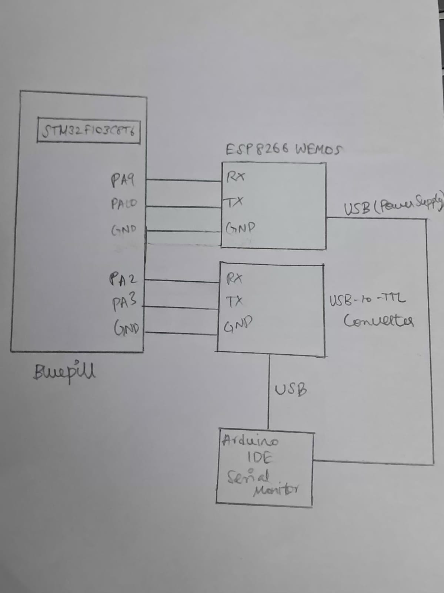

# CAT10 – STM32-Wemos Wi-Fi Modem Interface Using AT Commands

## EXP
CAT10

## DATE
05/10/2026

## NAME OF EXP
STM32-Wemos Wi-Fi Modem Interface Using AT Commands

## HARDWARE SETUP / PLATFORM

**Tasks 1, 2 and 3:**
- **Development Board:** STM32 Blue Pill
- **Microcontroller:** STM32F103C8T6
- **Processor Core:** ARM Cortex-M3
- **Wi-Fi Module:** Wemos D1 (ESP8266)
- **Communication:** UART using STM32 HAL libraries
- **PC Interface:** Arduino IDE Serial Monitor

**UART Configuration:**
- USART1: STM32–Wemos communication.
- USART2: STM32–PC communication.
- Baud rate: 115200
- Word length: 8 bits
- Stop bits: 1
- Parity: None
- Hardware flow control: None

## TASK NO
- Task 1 – Basic AT Command Communication
- Task 2 – Wi-Fi Configuration and Connection
- Task 3 – TCP Server Configuration

## Circuit Diagram




```text
          STM32F103C8T6 (Blue Pill)                  Wemos D1 (ESP8266)
          +------------------------+                +------------------+
          |         PA9 (USART1 TX)|--------------->| RX (GPIO3)
          |        PA10 (USART1 RX)|<---------------| TX (GPIO1)
          |                     GND|----------------| GND
          |                        |                | 3.3V External VCC
          |         PA2 (USART2 TX)|---> PC Monitor +------------------+
          |         PA3 (USART2 RX)|<--- 115200 Baud
          +------------------------+
```

## Core Logic / Pseudocode / Code Base

The experiment progressively develops UART-based communication between an STM32 microcontroller and an ESP8266 Wi-Fi module.

1. Establish UART communication between STM32 and Wemos using AT commands.
2. Receive responses from Wemos and forward them to the PC serial terminal.
3. Configure the ESP8266 in station mode and connect it to a Wi-Fi access point.
4. Retrieve the network IP information.
5. Enable multiple TCP connections and configure the ESP8266 as a TCP server on port 80.

### Task 1 – Basic UART Communication

**Pseudocode:**

```text
1. Initialize HAL, system clock, GPIO, USART1 and USART2.
2. Declare the AT command "AT\r\n".
3. Transmit the AT command through USART1.
4. Start receiving bytes from USART1.
5. For every successfully received byte, transmit it through USART2.
6. Continue receiving until the configured timeout expires.
7. Wait for a short delay.
```

### Task 2 – Wi-Fi Configuration and Connection

**Pseudocode:**

```text
1. Send AT commands: AT, AT+CWMODE=1, AT+CWDHCP=1,1, AT+CWJAP, AT+CIFSR
2. Transmit Wi-Fi connection command.
3. Wait up to 5000 ms for WIFI GOT IP and OK responses.
4. Forward collected response to the PC.
5. Send AT+CIFSR to retrieve IP information.
```

### Task 3 – TCP Server Configuration

**Pseudocode:**

```text
1. Perform Task 2 initialization and Wi-Fi connection.
2. Send AT+CIPMUX=1 to enable multiple TCP connections.
3. Send AT+CIPSERVER=1,80 to start TCP server on port 80.
4. Display the collected responses on the PC.
```

**Code Base:**
- `Core/Src/main.c` – Application source code.
- `.ioc` – STM32CubeMX configuration file.

## INFERENCE

The experiment demonstrates the progressive development of an STM32-based Wi-Fi communication system using the ESP8266 module.

Tasks 1–3 establish UART communication, configure Wi-Fi connectivity and start a TCP server.

The experiment demonstrates UART communication, ESP8266 AT command control, Wi-Fi station configuration and TCP server operation.
