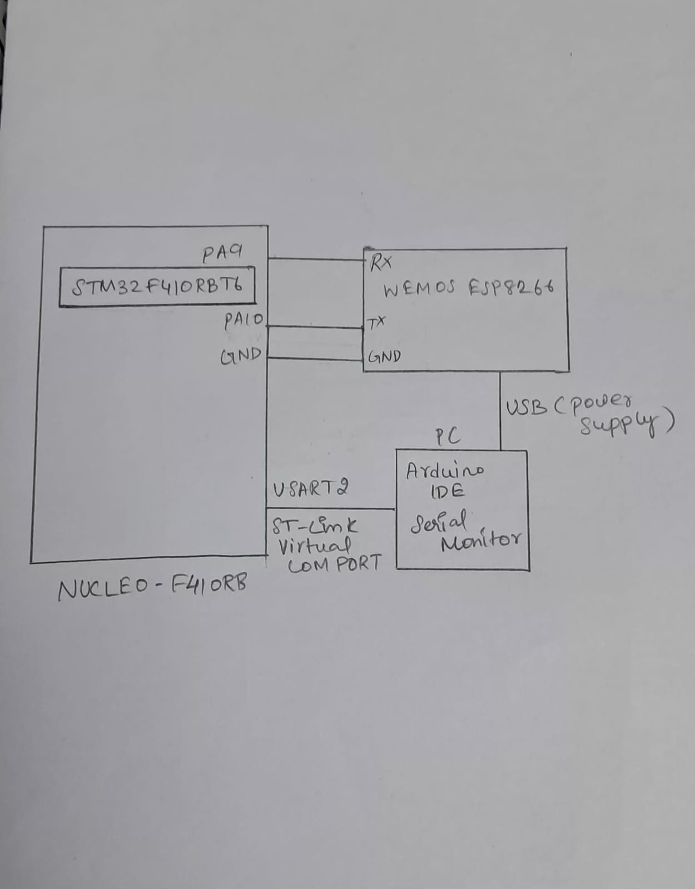

# CAT11 – HTTP Server: STM32–Wemos Wi-Fi Modem Using AT Commands

## EXP
CAT11

## DATE
12/10/2026

## NAME OF EXP
HTTP Server – STM32–Wemos Wi-Fi Modem Using AT Commands

## HARDWARE SETUP / PLATFORM
- **Development Board:** NUCLEO-F410RB
- **Microcontroller:** STM32F410RBT6
- **Processor Core:** ARM Cortex-M4
- **Wi-Fi Module:** Wemos D1 (ESP8266)
- **Sensor:** Not used in this experiment; a static HTTP response is generated.
- **Communication:** UART using STM32 HAL libraries
- **PC Interface:** Arduino IDE Serial Monitor through USART2
- **Node-RED:** Used as an additional HTTP client to send requests and display the received response.
- **Software Tools:** STM32CubeMX, Keil MDK, Arduino IDE, Node-RED

**UART Configuration:**
- USART1: Communication between STM32 and ESP8266/Wemos.
- USART2: Forwarding ESP8266 responses and debugging messages to the PC.
- Baud rate: 115200
- Word length: 8 bits
- Stop bits: 1
- Parity: None
- Hardware flow control: None

## TASK NO
- **Task 10C:** Configure ESP8266 as a TCP Server.
- **Task 10D:** Observe and Process HTTP Requests and Construct a Static HTTP Response.
- **Task 10E:** Use Node-RED as a Second HTTP Client of the STM32/ESP8266 HTTP Server.

## Circuit Diagram




```text
          STM32F410RB (Nucleo)                       Wemos D1 (ESP8266)
          +------------------------+                +------------------+
          |         PA9 (USART1 TX)|--------------->| RX (GPIO3)
          |        PA10 (USART1 RX)|<---------------| TX (GPIO1)
          |                     GND|----------------| GND
          |                        |                | TCP Server Port 80
          |         PA2 (USART2 TX)|---> PC Debug   +------------------+
          +------------------------+
          Wi-Fi Client: Browser / Node-RED HTTP GET -> ESP8266 (+IPD) -> STM32
```

## Core Logic / Pseudocode / Code Base

1. Initialize the STM32 HAL, system clock, GPIO, USART1 and USART2.
2. Send `AT` to verify communication with the ESP8266.
3. Configure the ESP8266 as a Wi-Fi station using `AT+CWMODE=1`.
4. Enable DHCP for station mode using `AT+CWDHCP=1,1`.
5. Connect the ESP8266 to the configured Wi-Fi access point.
6. Retrieve the network IP information using `AT+CIFSR`.
7. Enable multiple TCP connections using `AT+CIPMUX=1`.
8. Start the TCP server on port 80 using `AT+CIPSERVER=1,80`.
9. Continuously receive data from the ESP8266 through USART1.
10. Forward the received data to the PC through USART2 for monitoring.
11. Search the received data for a `+IPD` frame indicating incoming network data.
12. Extract the TCP connection ID and received data length from the `+IPD` frame.
13. Check whether the received payload begins with an HTTP `GET` or `POST` request.
14. Construct a static HTML response containing the HTTP status line, headers, blank line and HTML body.
15. Send `AT+CIPSEND` with the connection ID and response length.
16. Wait for the ESP8266 `>` prompt before transmitting the HTTP response.
17. Transmit the HTTP response through the ESP8266 to the requesting HTTP client.
18. Use Node-RED's HTTP Request node to send an HTTP GET request to the ESP8266 server.
19. Display the HTTP response received from the STM32 through the Node-RED Debug node.

### Pseudocode

```text
Step 1 – Initialize the STM32 and configure the ESP8266:
    Start HAL, configure clock, initialize GPIO, USART1, USART2.
    Send AT commands: AT, AT+CWMODE=1, AT+CWDHCP=1,1, AT+CWJAP.
    Wait for WIFI GOT IP and OK.
    Send AT+CIFSR, AT+CIPMUX=1, AT+CIPSERVER=1,80.

Step 2 – Receive and process an HTTP request:
    Continuously receive bytes from ESP8266 through USART1.
    Store received bytes in a buffer.
    If +IPD frame is found, extract connection ID and payload.
    If payload is HTTP GET or POST, call HTTP response function.

Step 3 – Construct and transmit the HTTP response:
    Build HTML body: "Hello from STM32! ESP8266 communication successful."
    Construct HTTP/1.1 200 OK response with headers and body.
    Send AT+CIPSEND command and wait for > prompt.
    Transmit the HTTP response.
    Send AT+CIPCLOSE to close the TCP connection.

Step 4 – Test using Node-RED:
    Configure Inject → HTTP Request → Debug flow in Node-RED.
    Set HTTP Request node URL to http://<ESP8266_IP>/.
    Deploy and trigger to observe STM32 HTTP response in Debug panel.
```

### Code Base

- `Core/Src/main.c` – Application source code.
- `.ioc` – STM32CubeMX configuration file.

**Important HAL functions:**
- `HAL_Init()`, `HAL_UART_Init()`, `HAL_UART_Transmit()`, `HAL_UART_Receive()`, `HAL_GetTick()`, `HAL_Delay()`

**User-defined functions:**
- `ESP_SendCommand()` – Sends an AT command and forwards the response to the PC.
- `ESP_ConnectWiFi()` – Sends the Wi-Fi connection command and checks for successful connection.
- `receiveResponse()` – Collects incoming ESP8266 data and passes it for processing.
- `ESP_ProcessReceivedData()` – Parses the `+IPD` frame and identifies HTTP requests.
- `ESP_SendHTTPResponse()` – Constructs and sends the HTTP response.

## INFERENCE

The STM32 successfully acts as the controller of an HTTP server using the ESP8266 Wi-Fi module. The ESP8266 handles the Wi-Fi and TCP communication, while the STM32 processes incoming HTTP request data and constructs the corresponding HTTP response.

The experiment demonstrates UART-based AT command communication, TCP server configuration, `+IPD` frame processing, HTTP response construction and transmission using `AT+CIPSEND`.

The HTTP server returns a static HTML response to requesting clients. The browser and Node-RED HTTP Request node can act as clients of the server.
