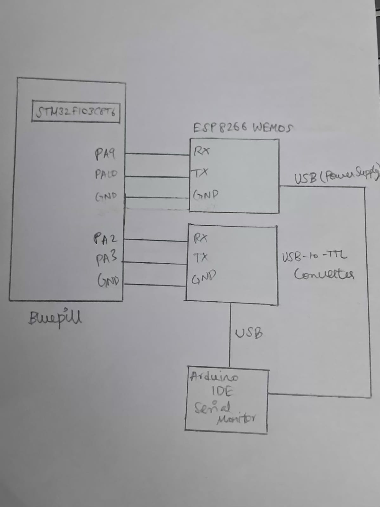

# CAT12 – STM32F401RE Cortex-M4: GPIO and User Input Programming

## EXP
CAT12

## DATE
14/10/2026

## NAME OF EXP
STM32F401RE Cortex-M4: GPIO and User Input Programming

## HARDWARE SETUP / PLATFORM
- **Development Board:** NUCLEO-F401RE
- **Microcontroller:** STM32F401RET6
- **Processor Core:** ARM Cortex-M4
- **On-board LED:** LD2 connected to GPIO PA5
- **On-board User Push Button:** B1 connected to GPIO PC13
- **Development Tools:** STM32CubeMX and Keil MDK
- **Software Library:** STM32 HAL

### Clock Configuration
The system clock is configured using the external high-speed clock (HSE) in bypass mode and the PLL.

Configuration used:
- HSE mode: Bypass
- PLL source: HSE
- PLLM: 25, PLLN: 168, PLLP: 2, PLLQ: 4
- AHB prescaler: 1
- APB1 prescaler: 2
- APB2 prescaler: 1

## TASK NO
- **Task 1:** On-board LED Bring-Up
- **Task 2:** On-board Switch Control with State Remembrance
- **Task 3:** Short-Press and Long-Press Detection

## Circuit Diagram




The experiments use the on-board peripherals of the NUCLEO-F401RE development board.

- LD2 (on-board LED) is connected to PA5.
- B1 (on-board user push button) is connected to PC13.

```text
          STM32F401RE (Nucleo-64)
          +------------------------+
          |           PA5 (Output) |----[ On-board Green LED LD2 ]
          |                        |
          |           PC13 (Input) |<---[ On-board Blue Button B1 (Active LOW) ]
          +------------------------+
          Features: 1 Hz Blink, State Retention Toggle, Rapid Strobe Mode
```

No external LED or push button is required for these tasks.

## Core Logic / Pseudocode / Code Base

### Task 1 – On-board LED Bring-Up

GPIO pin PA5 is configured as a push-pull output. The program continuously toggles the output state with a 100 ms delay.

```text
START
Initialize HAL, Configure system clock, Initialize GPIO

WHILE TRUE
    Toggle LED on PA5
    Wait for 100 milliseconds
END WHILE
END
```

### Task 2 – On-board Switch Control with State Remembrance

GPIO pin PC13 is configured as an input with internal pull-up, while PA5 is configured as an output.

```text
START
Initialize HAL, Configure system clock, Initialize GPIO
Configure PC13 as input with pull-up
Configure PA5 as output

WHILE TRUE
    Read button state from PC13
    IF button is pressed THEN Turn ON LED
    ELSE Turn OFF LED
    END IF
END WHILE
END
```

### Task 3 – Short-Press and Long-Press Detection

The program measures button press duration using `HAL_GetTick()`.

- Press duration below 250 ms → short press → toggle LED (or stop blinking).
- Press duration of 250 ms or more → long press → start continuous blinking.
- LED toggles every 100 ms while blinking is active.

```text
START
Initialize HAL, system clock, GPIO
pressed = 0, isBlinking = 0

WHILE TRUE
    Read button state from PC13

    IF button is pressed AND pressed == 0 THEN
        pressed = 1
        Store current tick as press_start

    ELSE IF button released AND pressed == 1 THEN
        pressed = 0
        duration = current tick - press_start

        IF duration < 250 ms THEN
            IF isBlinking == 0 THEN Toggle LED
            ELSE Turn OFF LED, Stop blinking
        ELSE
            IF isBlinking == 0 THEN Start blinking

    IF isBlinking == 1 AND elapsed >= 100 ms THEN
        Toggle LED, Update blink_start

END WHILE
END
```

### Code Base
- `Core/Src/main.c` – Application source code.
- `.ioc` – STM32CubeMX configuration file.

## INFERENCE

The experiments demonstrated GPIO output control, digital input reading and time-based user input detection using the NUCLEO-F401RE development board.

Task 1 verified on-board LED operation through GPIO output toggling. Task 2 demonstrated button-based LED control using GPIO input polling. Task 3 extended the application by measuring button press duration using the HAL tick counter and performing different LED operations based on short and long presses.

These experiments provided practical understanding of GPIO configuration, on-board peripheral interfacing, polling-based input detection and non-blocking time measurement using STM32 HAL.
