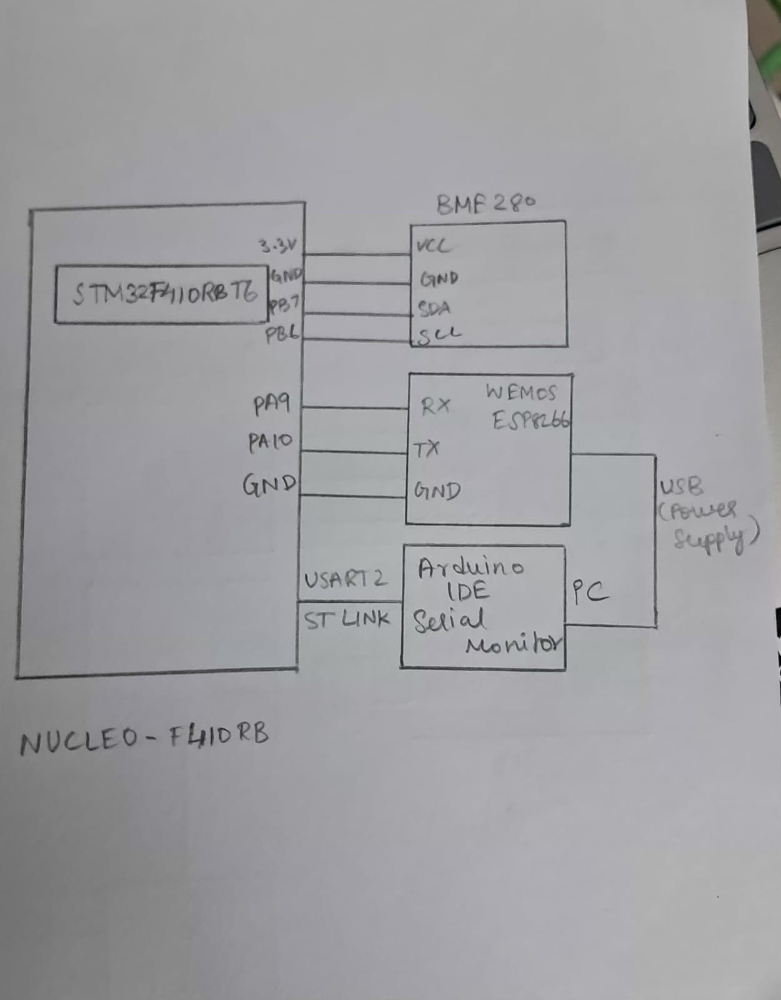

# CAT14 – BME280 Sensor Interfacing Using I²C and MQTT Using Custom Built ESP8266 API

## EXP
CAT14

## DATE
27/10/2026

## NAME OF EXP
BME280 Sensor Interfacing Using I²C and MQTT Using Custom Built ESP8266 API

## HARDWARE SETUP / PLATFORM
- **Development Board:** STM32 NUCLEO-F410RB
- **Microcontroller:** STM32F410RBT6
- **Processor Core:** ARM Cortex-M4
- **Environmental Sensor:** Bosch BME280
- **Wi-Fi Module:** ESP8266
- **Communication Protocols:**
  - I²C1 – Communication between STM32 and BME280
  - UART (USART1) – Communication between STM32 and ESP8266
  - UART (USART2) – Serial debugging and monitoring through ST-Link Virtual COM Port
  - MQTT – Publishing sensor data to the MQTT broker
- **I²C Configuration:** 100 kHz, 7-bit addressing
- **UART Configuration:** 115200 baud, 8 data bits, no parity, 1 stop bit (8N1)
- **MQTT Broker:** broker.emqx.io
- **MQTT Port:** 1883
- **MQTT Topic:** `iot/bme`
- **MQTT QoS:** 0
- **Software and Libraries:** STM32CubeMX, Keil MDK, STM32 HAL Library, Bosch BME280 Sensor API, Custom ESP8266 MQTT Library (ESPLib)

## TASK NO
CAT14 – BME280 Sensor Interfacing Using I²C and MQTT with a Custom-Built ESP8266 API.

## Circuit Diagram




```text
          STM32F410RB (Nucleo)                       Sensors & Transceiver
          +------------------------+                +----------------------+
          |          PB8 (I2C1 SCL)|--------------->| BME280 SCL (I2C)
          |          PB9 (I2C1 SDA)|<-------------->| BME280 SDA (I2C)
          |         PA9 (USART1 TX)|--------------->| ESP8266 RX (UART)
          |        PA10 (USART1 RX)|<---------------| ESP8266 TX (UART)
          |         PA2 (USART2 TX)|---> PC Debug   +----------------------+
          +------------------------+
          MQTT Telemetry: {"status":"success","temperature":T,"humidity":H,"pressure":P}
          Broker: broker.emqx.io:1883 | Topic: iot/bme | QoS: 0
```

The hardware setup consists of the STM32 NUCLEO-F410RB board, BME280 sensor module, and ESP8266 Wi-Fi module.

- BME280 VCC → 3.3V
- BME280 GND → GND
- BME280 SDA → STM32 I²C1 SDA
- BME280 SCL → STM32 I²C1 SCL
- ESP8266 TX → STM32 USART1 RX
- ESP8266 RX → STM32 USART1 TX
- ESP8266 GND → STM32 GND
- ESP8266 VCC → Appropriate 3.3V supply
- STM32 USART2 → ST-Link Virtual COM Port → PC

## Core Logic / Pseudocode / Code Base

The application collects environmental measurements from the BME280 sensor using the I²C communication protocol. The Bosch BME280 API is used to initialize the sensor, configure its operating settings, and obtain compensated temperature, pressure, and humidity values.

The STM32 constructs a JSON payload containing the sensor readings and publishes it to an MQTT broker through the ESP8266 Wi-Fi module using the custom ESP8266 MQTT library.

### Pseudocode

```text
START

1. SYSTEM INITIALIZATION
   Initialize STM32 HAL, system clock, GPIO, I2C1, USART1, USART2.

2. BME280 SENSOR INITIALIZATION
   Set BME280 device address to 0x76.
   Configure Bosch API interface with I2C read/write/delay callbacks.
   Call bme280_init().

3. BME280 CONFIGURATION
   Set temperature, pressure, humidity oversampling to 1×.
   Disable sensor filter.
   Apply settings with bme280_set_sensor_settings().
   Set sensor to NORMAL mode.

4. ESP8266 INITIALIZATION
   Initialize ESP8266 in Station Mode via USART1.
   Connect ESP8266 to Wi-Fi network.
   Configure single TCP connection mode.

5. MQTT BROKER CONNECTION
   Establish TCP connection: broker.emqx.io, Port 1883.
   Initialize MQTT client: Keep-alive=500, Clean session, Client ID=AN_Publisher.
   Connect MQTT client to broker.

6. CONTINUOUS SENSOR DATA ACQUISITION AND PUBLISHING

   WHILE TRUE DO
       Read temperature, pressure, humidity from BME280.

       IF sensor reading is successful THEN
           Store Temperature (°C), Pressure (hPa), Humidity (%RH).
           Construct JSON payload:
               {"status": "success", "temperature": T, "humidity": H, "pressure": P}
           Publish JSON payload to MQTT topic: "iot/bme", QoS=0.
           Transmit sensor readings through USART2 for serial monitoring.
       ELSE
           Print sensor reading failure message through USART2.
       END IF

       Wait for 1000 milliseconds.
   END WHILE

END
```

### JSON Payload Format

```json
{
  "status": "success",
  "temperature": 28.45,
  "humidity": 62.30,
  "pressure": 1008.72
}
```

### Code Base

| File | Purpose |
|---|---|
| `Core/Src/main.c` | Main application logic, peripheral initialization, sensor acquisition, JSON construction, and MQTT publishing |
| `bme280.c` | Bosch BME280 sensor driver implementation |
| `bme280.h` | BME280 API declarations and device structures |
| `bme280_defs.h` | BME280 constants, register definitions, and configuration macros |
| `ESPLib.c` | Custom ESP8266 and MQTT library implementation |
| `ESPLib.h` | Custom ESP8266 and MQTT library declarations |

| Function | Purpose |
|---|---|
| `bme280_init()` | Initializes the BME280 sensor |
| `bme280_set_sensor_settings()` | Configures sensor oversampling and filter settings |
| `bme280_set_sensor_mode()` | Sets the sensor to normal mode |
| `bme280_get_sensor_data()` | Obtains compensated sensor measurements |
| `user_i2c_read()` | Implements I²C register reading using STM32 HAL |
| `user_i2c_write()` | Implements I²C register writing using STM32 HAL |
| `ESP8266_Init()` | Initializes the ESP8266 module |
| `ESP8266_wifiConnect()` | Connects the ESP8266 to the Wi-Fi network |
| `MQTT_connectBroker()` | Establishes the MQTT client connection |
| `MQTT_publishTopic()` | Publishes sensor data to the specified MQTT topic |

## INFERENCE

The BME280 environmental sensor was successfully interfaced with the STM32 NUCLEO-F410RB development board using the I²C communication protocol and the Bosch BME280 Sensor API.

The STM32 acquired compensated temperature, pressure, and humidity measurements, converted the pressure readings from Pa to hPa, and formatted the sensor values into a JSON payload.

Using the custom ESP8266 MQTT library, the STM32 connected to a Wi-Fi network and an MQTT broker. The JSON-formatted sensor readings were published periodically to the MQTT topic `iot/bme` using QoS 0.

The published environmental data was received in Node-RED for monitoring and visualization, demonstrating an IoT-based environmental sensing and MQTT communication system.
